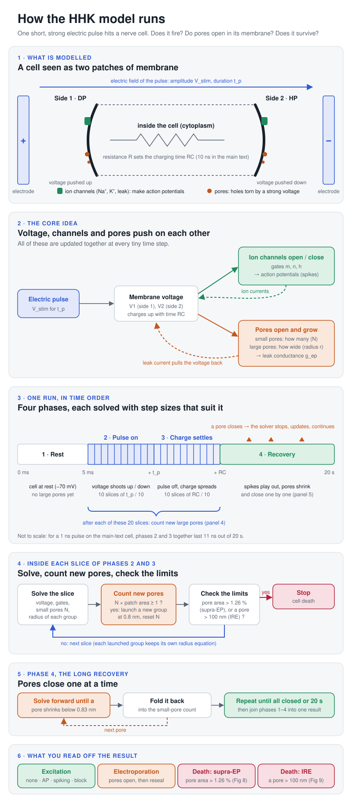

# Dynamical Regimes of Excitable Cells under Pulsed Electric Fields: From Excitation to Electroporation

[](https://doi.org/10.5281/zenodo.23409120)

MATLAB code and data accompanying:

> Md Rashid Ali Faridi, Rohit Manchanda, and Rochish M. Thaokar.
> *Dynamical Regimes of Excitable Cells under Pulsed Electric Fields: From Excitation to Electroporation.*
> Submitted to PLOS Computational Biology.

Archived code and data: Zenodo, DOI [10.5281/zenodo.23409120](https://doi.org/10.5281/zenodo.23409120)
(this DOI always points to the latest version).

Department of Chemical Engineering and Department of Biosciences and Bioengineering,
Indian Institute of Technology Bombay, Mumbai, India.

## Overview

The **HHK model** couples the Hodgkin–Huxley equations for a planar two-bilayer
neuron with Krassowska's Asymptotic Smoluchowski Equation (ASE) for
electroporation, including discrete large-pore radius evolution. It is used to
map excitation (single action potential, repetitive spiking, depolarisation
block), electroporation and cell-death thresholds for pulses from 1 ns to 1 ms.

### How the simulation works



## Requirements

- MATLAB R2020a or newer (developed and tested with R2023a on macOS). No
  toolboxes are needed: the simulations, figure scripts and the convergence
  study all use core MATLAB only.
- The convergence study (`model/RC_1e-5ms/Convergence_Test_HHK.m`, Tables
  S4–S5) counts spikes with its own `find_spikes` function. If you have the
  Signal Processing Toolbox, `findpeaks(VV, tt, 'MinPeakHeight', -20,
  'MinPeakDistance', 0.5)` can be used instead; it gives exactly the same
  peaks (checked on all saved voltage traces).
- The code uses only platform-independent paths and runs on Windows, macOS and
  Linux. Figures use the Times font; where it is not installed MATLAB substitutes
  a similar font, which changes only the typeface.

## Repository layout

```
model/                Simulation code, one self-contained folder per RC value
  RC_1e-5ms/          RC = 1e-5 ms (= 1e-8 s, main-text neuron); also convergence test
  RC_1e-4ms/          RC = 1e-4 ms (= 1e-7 s)
  RC_1e-3ms/          RC = 1e-3 ms (= 1e-6 s, SI neuron)
  IRE_RC_1e-5ms/      Irreversible-electroporation runs (pore growth not capped), RC = 1e-5 ms
  HH_without_EP/      Planar HH model without electroporation (HH_single_pulse.m, HH_Vstim_sweep.m,
                      HH_SD_threshold.m; set R in dynamics_HH.m)
  Smith2004_patch/    Electroporation of a single membrane patch (Smith et al. 2004 benchmark, S2 Fig)
figures_code/
  main/               Scripts for main-text figures
  SI/                 Scripts for Supplementary figures and tables
data/
  raw/                Saved simulation outputs (.mat) loaded by the figure scripts
  strength_duration/  Threshold tables (.csv) for strength–duration and pore plots
  processed/          Derived quantities (AP metrics)
figures/              Output folder for regenerated figures
docs/                 Schematic of the algorithm (algorithm.svg)
```

> **Note on RC units.** Time in the code is in ms, so `RC_1e-5ms` corresponds to
> RC = 10⁻⁸ s in the manuscript and `RC_1e-3ms` to RC = 10⁻⁶ s.

Each `model/` folder defines functions with the same names
(`dynamics_HH_with_electroporation.m`, `dynamics__HH_with_EP_shunt.m`, ...)
that differ in the cytoplasmic resistance `R`. **Do not add these RC
subfolders to the MATLAB path.** Use `run_HHK` (below), which picks the right
folder, or `cd` into the folder for the RC you want and run the driver script
there, so that MATLAB uses that folder's functions.

## Simulating your own pulse

From the repository root:

```matlab
setup                                   % once per MATLAB session
out = run_HHK(1500, 1e-4);              % V_stim = 1500 mV, pulse 100 ns, RC = 1e-8 s
plot_HHK(out)                           % all plots
plot_HHK(out, 'TMP_AP', 'radius')       % or only the ones you name
```

- **`V_stim`** is the pulse amplitude in mV.
- **`tp`** is the pulse duration in **ms**: `1e-6` = 1 ns, `1e-4` = 100 ns,
  `1e-3` = 1 µs, `1` = 1 ms.
- Options: `'RC'` (cell time constant in s: `1e-8` default, `1e-7`, `1e-6`),
  `'tf'` (simulated time in ms, default 20000; the pulse starts at 5 ms, so a
  shorter `tf` is faster if you only need the first action potentials), and
  `'SaveAs'` to save the result, e.g. `run_HHK(1500, 1e-4, 'SaveAs', 'run1.mat')`.

`out` contains the time `t` (ms), membrane potentials `V1`, `V2` (side 1 =
depolarised, side 2 = hyperpolarised), gating variables, small-pore densities
`N1`, `N2`, conductances `gep1`, `gep2`, fractional pore areas, large-pore radii,
and a `status` saying whether the run completed or stopped at cell death.
See `help run_HHK` and `help plot_HHK` for details and the list of plots
(`TMP`, `TMP_pulse`, `TMP_AP`, `gating`, `N`, `conductance`, `FPA`, `radius`).

`run_HHK` runs the unchanged model script used for the paper
(`model/RC_<...>/HHK_single_pulse.m`) on a temporary copy with your `V_stim`,
`tp` and `tf`, so results are identical to running that script by hand.

### Running the model scripts directly

The original driver scripts can also be run directly. Each `model/` RC folder
defines functions with the same names, so `cd` into the one you want first:

```matlab
setup                   % from the repository root, once per session
cd model/RC_1e-5ms
HHK_single_pulse        % one pulse: set V_stim, tp (ms) and tf in sections 4 and 6 of the script
plot_HHK                % plot the run that is in the workspace (or plot_HHK('TMP_AP', ...))
HHK_array_of_pulse      % a list of amplitudes V_stim_values at one tp (plots itself)
```

Results are left in the workspace as `t_tot` and `y_tot` (columns V1, V2, m1,
n1, h1, m2, n2, h2, N1, N2); nothing is saved unless you call `save` yourself.

The HH model without electroporation (the reference curves in Fig 6, S6 and
S9–S11 Figs) is run the same way from `model/HH_without_EP`:

```matlab
cd model/HH_without_EP
HH_single_pulse         % set V_stim, tp (ms) and tf at the top of the script
```

Its RC is set by `R` in `dynamics_HH.m`: `R = 10^-3` gives RC = 10⁻⁶ s (S6 Fig);
set `R = 10^-5` for the RC = 10⁻⁸ s traces (Fig 6, S9–S11 Figs).

The single-patch electroporation model of Smith et al. (2004), used for the
S2 Fig benchmark, is a separate script (explicit Euler, about 5 min):

```matlab
cd model/Smith2004_patch
electroporation_patch   % 1.25 V for 20 us; results t, Vm, K, rmax, rmean, ... in the workspace
```

The numerical convergence study (Tables S4–S5) is run with
`model/RC_1e-5ms/Convergence_Test_HHK.m` (uses `run_HHK_case.m`).

## Reproducing the figures

Each figure script is named after the figure it reproduces. From the repository root:

```matlab
setup                        % adds figures_code/ to the path (once per session)
Fig2_TMP_dynamics            % shows Fig 2a-c on screen
```

Each figure script also runs on its own (opened in the editor and run, or
`run('figures_code/main/Fig2_TMP_dynamics.m')`); `setup` is only needed to call
scripts by name from any folder and to use `save_figures`.

By default the panels are only **shown**, each in a window named after the panel
(e.g. `Fig5a`); nothing is written to disk. To also save them as PDF:

```matlab
save_figures(true)           % turn PDF saving on (save_figures(false) turns it off)
Fig2_TMP_dynamics            % -> figures/main/Fig2a.pdf, Fig2b.pdf, Fig2c.pdf
```

To regenerate and save every figure in one go:

```matlab
make_all_figures             % writes all panels to figures/main/ and figures/SI/
```

To run everything from a terminal (Windows, macOS or Linux), from the repository root:

```
matlab -nodisplay -batch "make_all_figures"
```

`-nodisplay` draws the figures off-screen, which is more reliable for unattended
runs. If you run individual scripts with `matlab -batch`, end with
`close all force`, otherwise MATLAB may not exit while panels are still open.

Only panels that appear in the paper or SI are saved. Output files are named
after the panel (`figures/main/Fig4b.pdf`, `figures/SI/S15_Fig_c.pdf`).

### Main text (`figures_code/main/`)

| Figure | Script | Output files | Data (under `data/`) |
|---|---|---|---|
| Fig 1 | Schematic (no code) | – | – |
| Fig 2 | `Fig2_TMP_dynamics.m` | `Fig2a–c` | `raw/100ns_1e5/HHK_100ns_1e5_SAP_RS_DB.mat` |
| Fig 3 | `Fig3a_SD_1ns_to_1ms.m`, `Fig3b_SD_10ns_to_1us.m`, `Fig3c_SD_1ns_to_20ns.m`, `Fig3_legend.m` | `Fig3a–c`, `Fig3_legend` | `strength_duration/SD_till_1ms_RC1e-5.csv` |
| Fig 4 | `Fig4_pore_conductance.m` | `Fig4a–d` | `raw/100ns_1e5/HHK_100ns_1e5_SAP_RS_DB.mat`, `raw/100mus_1e5/HHK_100mus_1e5.mat` |
| Fig 5 | `Fig5_channel_conductance.m` | `Fig5a–f` | `raw/100ns_1e5/HHK_100ns_1e5_SAP_RS_DB.mat` |
| Fig 6a | `Fig6a_TMP_1ns.m` | `Fig6a` | `raw/excitation_data/HH(K)_1ns_13457mV.mat` |
| Fig 6b–d | `Fig6bcd_AP_features_1ns.m` | `Fig6b–d` | AP features (13457–16000 mV) listed in the script |
| Fig 6e–f | `Fig6ef_currents_1ns.m` | `Fig6e`, `Fig6f` | `raw/excitation_data/HH_1ns_14500mV.mat`, `HH_1ns_15500mV.mat`, `raw/1ns_RC_1e5/HHK_1ns_1e5.mat` |
| Fig 7a | `Fig7a_thresholds_vs_RC.m` | `Fig7a`, `Fig7_legend` | thresholds listed in the script |
| Fig 7b–d | `Fig7bcd_safety_factor.m` | `Fig7b–d` | thresholds listed in the script |
| Fig 8 | `Fig8_supra_EP.m` | `Fig8a–f` | `raw/Cell_Death/HHK_supraEP_10ns.mat` |
| Fig 9 | `Fig9_IRE.m` | `Fig9a–d` | `raw/Cell_Death/2.9microseconds_1e5ms.mat` |
| Fig 10 | `Fig10_energy_landscape.m` | `Fig10` | – (computed from the model parameters) |

### Supplementary Information (`figures_code/SI/`)

| Figure / Table | Script | Output files | Data (under `data/`) |
|---|---|---|---|
| S1 Fig | Made in Mathematica (not included) | – | – |
| S2 Fig | `S02_Fig_Smith_benchmark.m` | `S2_Fig_a–d` | `raw/SI_data/Smith2004/euler_with_Gaussian_125.mat` (this work, from `model/Smith2004_patch/electroporation_patch.m`), `raw/SI_data/Smith2004/{TMP,Pores,rmax,rmean}_125.csv` (digitised from Smith et al. 2004) |
| S3 Fig | Made in Python (not included) | – | – |
| S4, S8, S22 Fig | Schematics (no code) | – | – |
| S5 Fig | `S05_Fig_Boinagrov_TMP_benchmark.m` | `S5_Fig_a–b` | `raw/SI_data/HH_Rashid_data_{point5us,10ns}.mat` (this work, RC = 10⁻⁷ s), `raw/SI_data/HH_boin_data_*.csv` (digitised from Boinagrov et al. 2010, Fig 4) |
| S6 Fig | `S06_Fig_HH_SD_benchmark.m` (thresholds from `model/HH_without_EP/HH_single_pulse.m`, one run per pulse duration) | `S6_Fig` | `strength_duration/RC1e-3ms_new-Table 1.csv` (columns 1–2 digitised from Boinagrov et al. 2010, Fig 3; columns 3–4 this work), `strength_duration/SD_rheobase_1e-3ms.csv` (Boinagrov, 2–20 ms), `strength_duration/SD_HH_long_1e-3ms.csv` (this work, 2–20 ms, from `model/HH_without_EP/HH_SD_threshold.m`) |
| S4, S5 Table | `model/RC_1e-5ms/Convergence_Test_HHK.m` | – | `model/RC_1e-5ms/Convergence_Test_HHK_results.mat` |
| S7 Fig | `S07_Fig_HH_vs_HHK_benchmark.m` | `S7_Fig_a–b` | `raw/100ns_1e5/HH_100ns_1e5_2000mV.mat`, `HHKv_100ns_1e5_2000mV.mat` |
| S7 Table | `S07_Table_AP_metrics.m` | `processed/AP_metrics_summary.mat` | `raw/100ns_1e5/HHK_100ns_1e5_SAPs_EP_noEP.mat`, `raw/HH_model_Boin/HH_Vstim_sweep_results.mat` (made by `model/HH_without_EP/HH_Vstim_sweep.m` with `R = 10^-5`) |
| S9 Fig | `S09_Fig_excitation_10us.m` | `S9_Fig_a–f` | `raw/excitation_data/HHK_10mus_376mV.mat`, `HH_10mus_404mV.mat` |
| S10 Fig | `S10_Fig_excitation_1us.m` | `S10_Fig_a–f` | `raw/excitation_data/HHK_1mus_1159mV.mat`, `HH_1mus_1194mV.mat` |
| S11 Fig | `S11_Fig_excitation_1ns.m` | `S11_Fig_a–f` | `raw/excitation_data/HHK_1ns_12982mV.mat`, `HH_1ns_13457mV.mat` |
| S12, S13 Fig | `S12_S13_Fig_gating_variables.m` | `S12_S13_Fig_gating/` (m1, n1, h1 → S12; m2, n2, h2 → S13) | `raw/100ns_1e5/HHK_100ns_1e5_SAP_RS_DB.mat` |
| S14 Fig | `S14ab_Fig_pores_RC10ns.m`, `S14cd_Fig_pores_RC1us.m` | `S14_Fig_a–d` | `strength_duration/*.csv` |
| S15 Fig | `S15ab_Fig_pore_radius_SAP_EP.m`, `S15cd_Fig_pore_radius_RS.m`, `S15ef_Fig_pore_radius_DB.m` | `S15_Fig_a–f` | `raw/100ns_1e5/HHK_100ns_1e5_{SAP_EP,RS,DB}.mat` |
| S16 Fig | `S16_Fig_ionic_currents.m` | `S16_Fig_a–f` | `raw/100ns_1e5/HHK_100ns_1e5_SAP_RS_DB.mat` |
| S17 Fig | `S17_Fig_AP_features.m` (run `S07_Table_AP_metrics.m` first to rebuild its input) | `S17_Fig` | `processed/AP_metrics_summary.mat` |
| S18 Fig | `S18a_Fig_SD_10ns_to_1ms.m`, `S18bc_Fig_SD_10ns_to_3us.m` | `S18_Fig_a–c` | `strength_duration/RC1e-3ms_new-Table 1.csv` |
| S19 Fig | `S19a_Fig_relative_SD_RC10ns.m`, `S19b_Fig_relative_SD_RC1us.m` | `S19_Fig_a–b` | `strength_duration/%SD-RC1e-5ms.csv`, `%SD-RC1e-3ms.csv` |
| S20 Fig | `S20_Fig_supra_EP_DP.m` | `S20_Fig_a–b` | `raw/Cell_Death/HHK_supraEP_10ns.mat` |
| S21 Fig | `S21_Fig_IRE_DP.m` | `S21_Fig` | `raw/Cell_Death/2.9microseconds_1e5ms.mat` |

`compute_AP_metrics.m` (in `figures_code/SI/`) is a helper function used by
`S07_Table_AP_metrics.m`.

Scripts reproduce the plotted data in each panel. Final figure layout, legends,
and annotations were adjusted manually for publication.

## Regenerating the cell-death data

Both cell-death datasets were produced with
`model/IRE_RC_1e-5ms/Irreversible_EP_HHK_single_pulse.m`, which keeps integrating
past the cell-death limits (the standard drivers stop there). Fig 8 shows cell
death by **supra-electroporation** (fractional pore area above 0.0126 on either
side); Fig 9 shows cell death by **irreversible electroporation** (a pore radius
above 100 nm). Set, at the top of the script:

| Dataset | Figures | `V_stim` (mV) | `tp` (ms) | `tf` (ms) |
|---|---|---|---|---|
| `raw/Cell_Death/HHK_supraEP_10ns.mat` | Fig 8, S20 Fig | 4384 | `1e-5` (10 ns) | 20000 |
| `raw/Cell_Death/2.9microseconds_1e5ms.mat` (67 MB) | Fig 9, S21 Fig | 1890 | `2.9e-3` (2.9 µs) | 20000 |

Both runs used `tf = 20000`; the script's default is `tf = 60000`, so set it
explicitly when regenerating these files.

## Where the data come from

Every file in `data/raw/` was produced by one of the model scripts. The
pulse settings below are stored in the files themselves wherever the whole
workspace was saved. All HHK runs use `ton = 5` ms and `tf = 20000` ms.
Times are in ms in the code (`tp = 1e-4` is 100 ns).

| File (under `data/raw/`) | Made with | Settings |
|---|---|---|
| `100ns_1e5/HHK_100ns_1e5_SAP_RS_DB.mat` | `model/RC_1e-5ms/HHK_array_of_pulse.m` | `tp = 1e-4`, `V_stim_values = [1557 2100 2300 2479]` |
| `100ns_1e5/HHK_100ns_1e5_SAPs_EP_noEP.mat` | `model/RC_1e-5ms/HHK_array_of_pulse.m` | `tp = 1e-4`, `V_stim_values = [1560 1600 … 1995]` (13 values) |
| `100ns_1e5/HHK_100ns_1e5_SAP_EP.mat`, `_RS.mat`, `_DB.mat` | `model/RC_1e-5ms/HHK_single_pulse.m` | `tp = 1e-4`; `V_stim` = 2100, 2300, 2479 |
| `100ns_1e5/HHKv_100ns_1e5_2000mV.mat` | `model/RC_1e-5ms/HHK_single_pulse.m` with `flag1 = flag2 = 0` (electroporation off) | `tp = 1e-4`, `V_stim = 2000` |
| `100ns_1e5/HH_100ns_1e5_2000mV.mat` | `model/HH_without_EP/HH_single_pulse.m`, `R = 10^-5` | `tp = 1e-4`, `V_stim = 2000` |
| `100mus_1e5/HHK_100mus_1e5.mat` | `model/RC_1e-5ms/HHK_array_of_pulse.m` | `tp = 0.1`, `V_stim_values = 867` |
| `1ns_RC_1e5/HHK_1ns_1e5.mat` | `model/RC_1e-5ms/HHK_array_of_pulse.m` | `tp = 1e-6`, `V_stim_values = [13457 14500 15500]` |
| `excitation_data/HHK_1ns_13457mV.mat` | `model/RC_1e-5ms/HHK_array_of_pulse.m` | `tp = 1e-6`, `V_stim_values = 13457` |
| `excitation_data/HHK_<tp>_<V>mV.mat` (other) | `model/RC_1e-5ms/HHK_single_pulse.m` | pulse and `V_stim` in the file name (`10mus` = `tp 1e-2`, `1mus` = `1e-3`, `1ns` = `1e-6`) |
| `excitation_data/HH_<tp>_<V>mV.mat` | `model/HH_without_EP/HH_single_pulse.m`, `R = 10^-5`, `tf = 100` | pulse and `V_stim` in the file name |
| `Cell_Death/HHK_supraEP_10ns.mat` | `model/IRE_RC_1e-5ms/Irreversible_EP_HHK_single_pulse.m` | `tp = 1e-5`, `V_stim = 4384`, `tf = 20000` |
| `Cell_Death/2.9microseconds_1e5ms.mat` | `model/IRE_RC_1e-5ms/Irreversible_EP_HHK_single_pulse.m` | `tp = 2.9e-3`, `V_stim = 1890`, `tf = 20000` |
| `HH_model_Boin/HH_Vstim_sweep_results.mat` | `model/HH_without_EP/HH_Vstim_sweep.m`, `R = 10^-5` | `tp = 1e-4`, 13 values of `V_stim` (1560–1995) |
| `SI_data/Smith2004/euler_with_Gaussian_125.mat` | `model/Smith2004_patch/electroporation_patch.m` | `V0 = 1.25` V for the whole `tf = 20e-6` s, `dt = 1e-10` s, `N_0 = 1.5e9`; launch radii are random, so a rerun matches to within 1e-7 V in Vm and a few pores in K |
| `SI_data/HH_Rashid_data_point5us.mat`, `_10ns.mat` | `model/HH_without_EP/HH_single_pulse.m`, `R = 10^-4`, `tf = 20` | `tp = 5e-4`, `V_stim = 1355`; `tp = 1e-5`, `V_stim = 11256` |

The HHK drivers save nothing by default. Either uncomment the `save` block at
the end of the script, or call `save(...)` after the run. The `HHK_*` files
above were saved as the whole workspace, so `load` restores every variable
(`t_tot`, `y_tot`, `gshunt_1`, `solutions1`, ...).

`excitation_data/HHK_1ns_12982mV.mat` (S11 Fig) was made with an earlier
version of `HHK_single_pulse.m`. With the current code the 1 ns excitation
threshold is 12928 mV, and a rerun at 12982 mV gives the action potential
about 4 ms earlier than in the saved file.

## License

Code is released under the MIT License (see `LICENSE`).

## Citation

If you use this code, please cite the paper above. Until it is published, cite this repository
(GitHub's "Cite this repository" button, generated from `CITATION.cff`).

## Contact

- Code and technical questions: Md Rashid Ali Faridi — alifaridirashid@gmail.com
  (or open an issue on GitHub: https://github.com/rashidcompneuro/HH-Electroporation-PLOSCB/issues)
- Corresponding author: Rochish M. Thaokar — rochish@che.iitb.ac.in